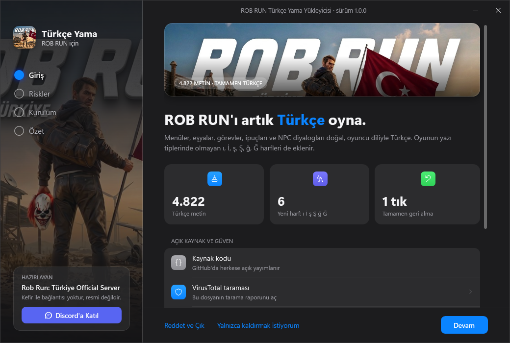
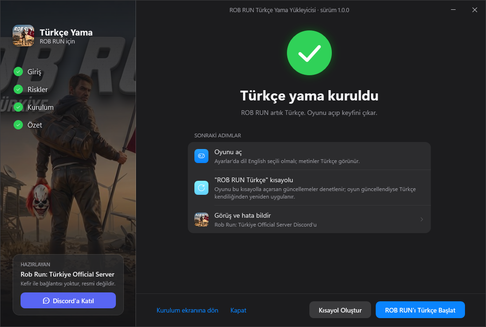
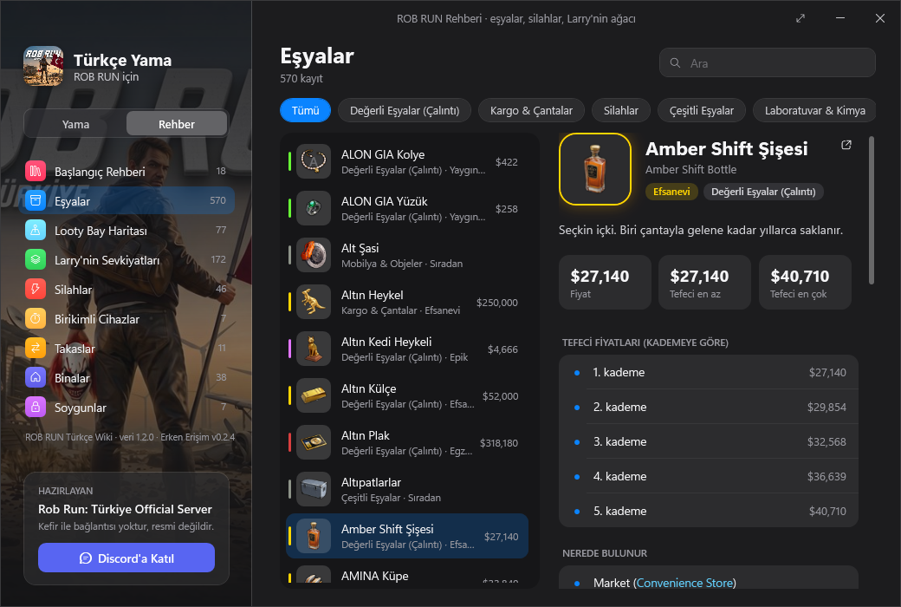
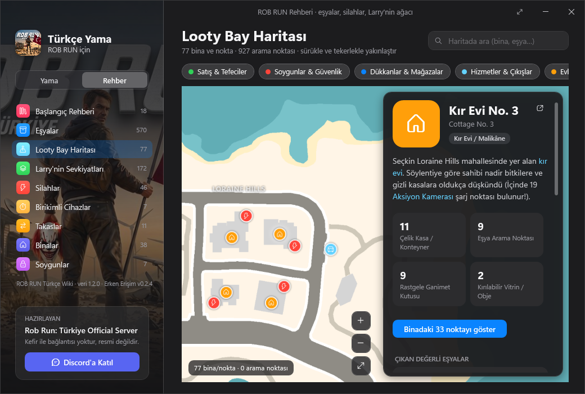
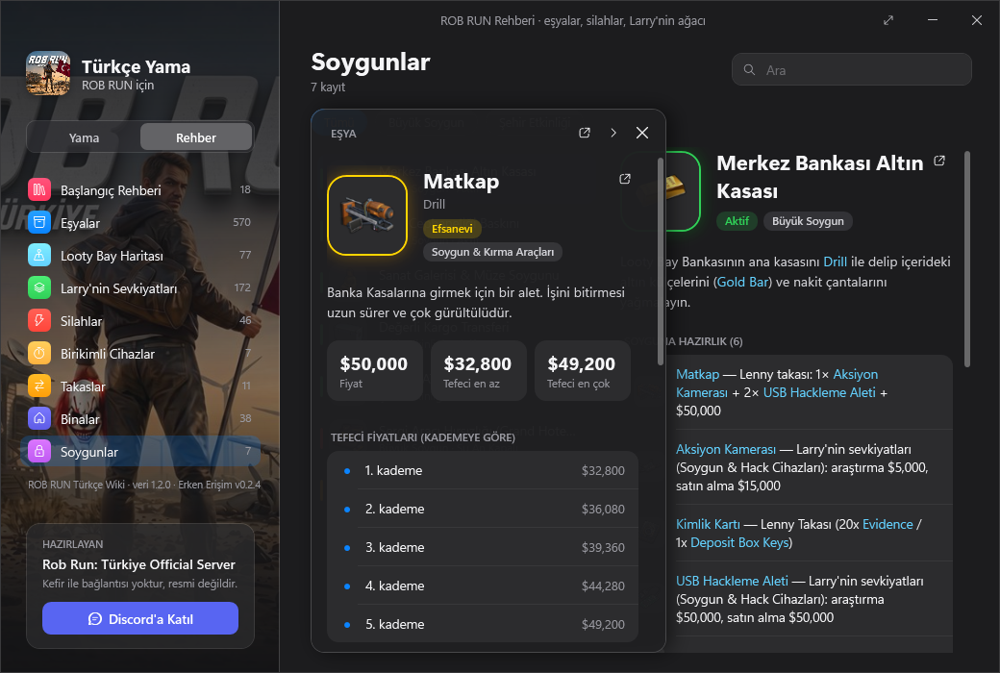

# ROB RUN Türkçe Yama

ROB RUN (Kefir, Steam) için **topluluk yapımı, açık kaynak** Türkçe çeviri yaması.
**Hazırlayan:** Rob Run: Türkiye Official Server. Topluluğun Discord sunucusu: https://discord.gg/ZMrsW2MuYW
(Sunucu bir oyuncu topluluğudur; Kefir ile bağlantısı yoktur. Yama resmi değildir.)



Oyundaki 4.800'den fazla metni (menüler, eşyalar, görevler, NPC diyalogları, ipuçları) Türkçeye çevirir. Oyunun yazı tiplerinde olmayan **ı İ ş Ş ğ Ğ** harflerini de ekler. **Oyun klasöründeki (Steam) hiçbir dosyayı değiştirmez.**

> ⚠️ **Bu yama resmi değildir ve hesap kapatma (ban) riski taşır.** Kurmadan önce [RISKLER.md](RISKLER.md) dosyasını mutlaka okuyun.
> Kısaca: ROB RUN, Easy Anti-Cheat kullanır ve kullanım koşulları çeviri yapmayı yasaklar. Yama oyun dosyalarına dokunmaz ama oyun yine de değiştirilmiş içerik yükler; riski kurulumu yapan kişi üstlenir. "%0 ban riski" diye bir şey yoktur.

---

## Kurulum

1. [Releases](../../releases) sayfasından `RobRunTurkceYama.exe` dosyasını indirin.
2. ROB RUN'ı tamamen kapatın.
3. Exe'yi çalıştırın. Program oyun klasörünü Steam kütüphanenizden otomatik bulur. Bulamazsa Kurulum adımındaki **Değiştir…** düğmesiyle klasörü siz seçersiniz.
4. **Giriş** sayfasında yamanın amacını, kaynak kodu ve VirusTotal bağlantılarını ve bu dosyanın SHA-256 özetini görürsünüz.
5. **Riskler** sayfasını okuyun ve **Devam** deyin. Açılan pencerede **"Riskleri okudum ve anladım"** anahtarını açıp **Kabul Ediyorum**'a basın. **Reddet** derseniz hiçbir dosya değişmez.
6. **Kurulum** sayfasında **Kur** düğmesine basın. Yönetici izni gerekmez.
7. Son ekranda **Kısayol Oluştur**'a basın (önerilir), ardından **ROB RUN'ı Türkçe Başlat** deyin.
8. Oyunda dil olarak **English** seçili olmalıdır. Türkçe metinler İngilizcenin yerine geçer.



## Rehber (ROB RUN Türkçe Wiki)

Sol üstteki **Yama | Rehber** geçişiyle uygulamanın içinden oyun rehberini açabilirsiniz. Yamayı kurmanız gerekmez, internet de gerekmez; veriler uygulamanın içindedir.

Yama kuruluysa uygulama kurulum adımlarını atlayıp **doğrudan Rehber'le açılır**. Oyun güncellendiyse doğrudan **Yeniden Kur** ekranı gelir. ROB RUN açıksa **Oyunu Kapat / Rehberle Devam Et** diye sorar. "Oyunu Kapat" oyunun penceresine kapanma isteği gönderir, yani X'e basmak gibidir; zorla sonlandırmaz.



| Bölüm | İçerik |
|---|---|
| **Yerleşim ve Üs** | Arsa nasıl alınır, ev nasıl kurulup geliştirilir, para aklama, üretim tezgâhları, kaçak mal paketleme, garaj, üs savunması ve baskın, yerleşim sahipliği ve vergi, klanlar ve Gölge Vali. Metinler oyunun kendi açıklamalarından; bedeller Larry'nin sevkiyatlarından |
| **Başlangıç Rehberi** | Adım adım ilk saatler, para kazanma yöntemleri (zorluk, süre, kazanç), sık yapılan hatalar; adımlardan haritaya ve sevkiyat planına geçiş |
| **Eşyalar** (569) | Kategori ve nadirlik, fiyat, kademeye göre tefeci fiyatları, nerede bulunduğu, hangi binalarda çıktığı, **haritada göster** |
| **Looty Bay Haritası** | 77 bina ve önemli nokta, 927 arama noktası (kasa, dolap, vitrin, şarj noktası…). Yakınlaştırma/kaydırma, katmanlar, arama. Binalarda kilitli odalar ve içindekiler, cihaz şarj noktaları, özel görevler |
| **Larry'nin Sevkiyatları** (172) | 8 dal; araştırma ve satın alma bedelleri, açılma sırası. **Planlayıcı:** düğümleri gerekenleriyle birlikte plana ekler, toplam bedeli hesaplar; hazır başlangıç paketi |
| **Silahlar** (46) | Hasar, kafaya hasar, atış hızı, DPS, şarjör, menzil, şarjör değiştirme ve nişan alma süreleri |
| **Birikimli Cihazlar** (7) | Kamera, USB, tablet…: kaç puanda dolduğu, nasıl doldurulduğu, dolunca ne işe yaradığı; şarj noktalarını haritada gösterme |
| **Takaslar** (11) | Gereken eşyalar ve nakit, nerede yapıldığı, sonuç |
| **Binalar** (38) | Türü, açıklaması, içinde bulunabilecek eşyalar |
| **Soygunlar** (7) | Yer, durum, gereken aletler, adım adım yapılışı |



- **Her şey birbirine bağlıdır:** Metinlerde geçen eşya, soygun, bina ve cihaz adları tıklanabilir. Tıklayınca solda bir **önizleme penceresi** açılır; buradan ayrıntıya bakıp Geri ile dönebilir ya da kaydın sayfasına geçebilirsiniz.
- **Ne işe yarar, nerede kullanılır:** Her eşya sayfası, o eşyanın geçtiği soygunları, takasları, harita noktalarını ve rehber adımlarını listeler. Kademeli eşyalarda (ör. Şifre Çözücü yeşil/mor/altın) diğer kademeler de gösterilir.
- **Soyguna hazırlık:** Her soygunda gereken eşyalar ve her birinin nasıl elde edildiği listelenir (ör. Matkap ← 1× Aksiyon Kamerası + 2× USB Hackleme Aleti + $50.000).
- **Ayrı pencere (PiP):** Bir kayıt, hazırlık listesi ya da harita, oyunun üstünde kalan küçük bir pencerede açılabilir. Pencere sabitlenebilir ve saydamlaştırılabilir. Oyunun üstünde görünmesi için oyunda **kenarlıksız pencere** modu seçili olmalıdır.
- **Tam ekran:** Başlık çubuğundaki düğme ya da **F11**. Pencere kenarından boyutlandırılabilir.
- Eşya adları, Türkçe yamadaki adlarla birebir aynıdır; oyunda ne görüyorsanız Rehber'de de o yazar.


- Her bölümde arama ve filtreler vardır. Kayıtlar birbirine bağlıdır: bir binadaki eşyaya, bir eşyanın takasına ya da Larry'nin ağacındaki düğümüne tıklayarak geçebilirsiniz.
- Rehber verisi (`wiki.json`) de çeviri gibi GitHub'dan **imzalı** olarak güncellenir.

Veri, Rob Run: Türkiye Official Server'ın **ROB RUN Türkçe Wiki** projesinden [`tools/wiki-donustur.ps1`](tools/wiki-donustur.ps1) ile üretilir:

```bash
pwsh tools/wiki-donustur.ps1 -Kaynak <wiki klasörü> -Surum 1.0.1
```

Betik şunları yapar:
- `data.js`'teki eşya adlarını yamanın çevirileriyle eşler ve terimleri çeviri rehberine uydurur (ör. fence = tefeci).
- `map_data_tr.js`'ten Looty Bay haritasını alır.
- `app.js`'teki rehber içeriklerini [`tools/wiki-rehber-cikar.mjs`](tools/wiki-rehber-cikar.mjs) ile çıkarır. Bunun için Node.js gerekir. Yalnızca veri değişmezleri, izole bir bağlamda değerlendirilir; sitenin kodu çalıştırılmaz.
- Simgeleri küçültüp PNG'ye çevirerek `wiki/simgeler/` klasörüne yazar. Yalnızca wiki'nin kendi `icons/` klasörü ve şehir haritası kullanılır.

## "ROB RUN Türkçe" kısayolu (başlatıcı)

**Kısayol Oluştur** düğmesi, programın bir kopyasını `%LOCALAPPDATA%\RobRunTurkceYama\uygulama\` klasörüne koyar. Masaüstüne ve Başlat menüsüne de **ROB RUN Türkçe** kısayolunu ekler. Oyunu bu kısayolla açtığınızda program sırasıyla şunları yapar:

1. GitHub'da yeni çeviri veya program sürümü var mı diye bakar (en fazla birkaç saniye). İnternet yoksa bu adımı atlar.
2. Oyun güncellendiyse ya da yeni çeviri geldiyse Türkçeyi kendiliğinden yeniden uygular.
3. ROB RUN'ı Steam üzerinden (`steam://rungameid/4262460`) başlatır ve kapanır.

Yama hiç kurulmadıysa başlatıcı hiçbir şey yapmaz, ana pencereyi açar; riskleri kabul etmeden hiçbir dosya yazılmaz. Oyun zaten açıksa da hiçbir şeye dokunmaz.

## Kaldırma

Exe'yi çalıştırıp **Yamayı Kaldır** düğmesine basın; Türkçe önbellek dosyaları ve "ROB RUN Türkçe" kısayolları silinir. Programın kendi verileri `%LOCALAPPDATA%\RobRunTurkceYama` klasöründedir, bu klasörü de silebilirsiniz. Elle kaldırmak için `%USERPROFILE%\AppData\LocalLow\Kefir\ROB RUN\com.unity.addressables` klasörünü silmeniz de yeterlidir. Steam'in "bütünlüğü doğrula" özelliği bu klasöre bakmaz.

## Nasıl çalışır?

ROB RUN, dosyalarını Unity Addressables ile yükler. Oyunun ayarları (`StreamingAssets\aa\settings.json`) açılışta önce oyunun kendi **önbellek klasörüne** (`AppData\LocalLow\Kefir\ROB RUN\com.unity.addressables`) bakar. Orada oyunun güncel sürümüyle aynı özete (`.hash`) sahip bir katalog varsa onu kullanır. Yükleyici bu klasöre dört dosya koyar:

| Önbellekteki dosya | Ne işe yarar |
|---|---|
| `localization-string-tables-english(unitedstates)(en-us)_assets_all_turkce__.bundle` | Oyunun İngilizce metin paketinin Türkçe kopyası (anahtarlar ve biçim etiketleri aynen korunur) |
| `inbuild_assets_all_turkce__.bundle` | Yazı tiplerine ı İ ş Ş ğ Ğ eklenmiş kopya. Harfler mevcut harf parçalarından üretilir (ş = s + ç'nin çengeli, ğ = g + й'nin kısa işareti, ı = i'nin noktasız gövdesi, İ = I + nokta). |
| `catalog_<tarih>.bin` | Oyunun kendi kataloğunun kopyası. Yalnızca bu iki paketin adresi önbellekteki kopyaları gösterecek şekilde değiştirilir. Adresler aynı uzunlukta tutulur, katalogdaki başka hiçbir bayt değişmez. |
| `catalog_<tarih>.hash` | Oyunun kendi özet dosyasının birebir kopyası |

**Değişmeyenler:** Oyun klasöründeki tüm dosyalar (`ROB RUN.exe`, `GameAssembly.dll`, paketler, katalog), Easy Anti-Cheat dosyaları, kayıtlarınız ve hesabınız. Program oyunun belleğine dokunmaz ve oyunla birlikte çalışmaz; işini bitirip kapanır.

- **Durum kaydı:** `%LOCALAPPDATA%\RobRunTurkceYama\yedek\durum.json`. Yazılan her dosyanın SHA-256 özeti tutulur; "Kaldır" yalnızca bu dosyaları siler.
- **Eski sürümden geçiş:** Önceki sürüm oyun klasöründeki iki paketi değiştiriyordu. O sürümle kurulum yapıldıysa yeni sürüm önce o dosyaları yedekten geri yükler.
- **Ağ:** Program yalnızca **GitHub**'a bağlanır (`api.github.com` ve bu deponun sürüm dosyaları). Telemetri ve veri gönderimi yoktur; istekler `RobRunTurkceYama` adıyla yapılır ve kişisel bilgi içermez. Ağ kodunun tamamı [`Updater.cs`](src/RobRunTurkce/Updater.cs) dosyasındadır. GitHub, VirusTotal ve Discord bağlantılarına tıklarsanız bu bağlantılar sizin tarayıcınızda açılır.
- **İmzalı güncellemeler:** Her sürümde bir `SHA256SUMS.txt` dosyası vardır. Bu dosya sürüm numaralarını ve dosya özetlerini listeler ve proje sahibindeki **gizli anahtarla** imzalanır (`SHA256SUMS.txt.sig`, RSA-3072 / SHA-256). Exe'nin içinde yalnızca [açık anahtar](assets/guncelleme-acik-anahtar.xml) bulunur. Program şu durumlarda dosyayı kullanmaz: imza tutmuyorsa, özet listedekiyle eşleşmiyorsa ya da sürüm daha eskiyse. Bu sayede GitHub hesabı ele geçirilse bile oyunculara sahte exe veya çeviri dağıtılamaz.
  - Yeni **çeviri** sessizce indirilir (`%LOCALAPPDATA%\RobRunTurkceYama\ceviri\tr.json`).
  - Yeni **program** sürümü ana pencerede "Güncelle" kartıyla sunulur. Başlatıcı ise doğrulanmış yeni sürüme kendiliğinden geçer: eski exe `.old` olur ve yeni sürüm açılınca silinir.
  - `release.json` içindeki `github` alanı boşsa güncelleme denetimi tamamen kapalıdır ve program internete hiç bağlanmaz.
- **VirusTotal bağlantısı:** Program kendi SHA-256 özetini hesaplar ve `https://www.virustotal.com/gui/file/<özet>` adresini oluşturur. Bağlantı her zaman çalıştırdığınız dosyanın kendi taramasını gösterir.

## Antivirüs neden uyarı verebilir?

Exe **dijital olarak imzalanmamıştır**. Kod imzalama sertifikası yıllık ücretlidir ve gönüllü bir topluluk projesi için pahalıdır. Windows SmartScreen ve bazı antivirüsler şu nedenlerle uyarı verebilir:

- İmzasız ve yeni bir program olması ("tanınmayan yayıncı").
- Başka bir programın önbellek dosyalarını yazması.
- Bir bağımlılığın (AssetsTools.NET) exe'nin içine gömülü olması ve çalışma anında yüklenmesi.
- İnternetten kendi yeni sürümünü indirip kendini değiştirebilmesi, masaüstüne kısayol oluşturması. Bunlar başlatıcı özelliği içindir; indirilen exe imza doğrulamasından geçmeden çalıştırılmaz.

Bunlar zararlı yazılım olduğu anlamına gelmez, ama bize körü körüne güvenmeniz de gerekmez:
- Kaynak kodun tamamı bu depodadır. Exe'yi aşağıdaki adımlarla **kendiniz derleyebilirsiniz**.
- Release sayfasında exe'nin SHA-256 özeti yayımlanır. İndirdiğiniz dosyayı şu komutla karşılaştırabilirsiniz:

```bash
certutil -hashfile RobRunTurkceYama.exe SHA256
```

## Kaynaktan derleme

Gereksinim: [.NET SDK](https://dotnet.microsoft.com/download) 8 veya üstü (Windows). Arayüz WPF ile yazılmıştır. Hedef çatı .NET Framework 4.8'dir; bu sürüm Windows 10 ve 11'de zaten yüklü olduğu için kullanıcının ayrıca bir şey kurması gerekmez.

```bash
dotnet build src/RobRunTurkce/RobRunTurkce.csproj -c Release
```

Çıktı: `src/RobRunTurkce/bin/Release/net48/RobRunTurkceYama.exe`. Bu tek bir dosyadır; çeviri, görseller ve bağımlılık içine gömülüdür.

Kendi derlediğiniz exe de resmi sürümlerden güncelleme alır; çünkü imzayı doğrulayan açık anahtar depodadır. Kendi çatalınızı (fork) dağıtacaksanız kendi anahtar çiftinizi üretin ve `assets/guncelleme-acik-anahtar.xml` dosyasını değiştirin.

### Sürüm yayımlama (bakım yapanlar için)

1. `release.json` içindeki `github` alanına deponun adresini yazın (ör. `https://github.com/<sahip>/<depo>`). Yalnızca `https://` ile başlayan bağlantılar kabul edilir.
2. Program sürümü için `RobRunTurkce.csproj` dosyasındaki `<Version>` değerini, çeviri sürümü için `translations/tr.json` içindeki `_bilgi.surum` değerini artırın.
3. `powershell -ExecutionPolicy Bypass -File build.ps1` komutunu çalıştırın. Betik `dist/` klasörüne şunları koyar: `RobRunTurkceYama.exe`, `tr.json`, `wiki.json`, `SHA256SUMS.txt` ve imza dosyası `SHA256SUMS.txt.sig`. Rehber verisini güncellediyseniz `wiki/wiki.json` içindeki `_bilgi.surum` değerini de artırın.
4. GitHub'da yeni bir release açın ve bu beş dosyayı ekleyin. Programlar "latest release"e bakar.

İmza için gereken gizli anahtar varsayılan olarak `%USERPROFILE%\.robrun-turkce-yama\imza-anahtari-GIZLI.xml` konumundadır (`ROBRUN_IMZA_ANAHTARI` ortam değişkeniyle değiştirilebilir). Bu dosya **asla depoya konmaz ve paylaşılmaz**; yedeğini güvenli bir yerde saklayın. Kaybolursa yeni anahtarla imzalanan sürümleri eski programlar kabul etmez; oyuncuların yeni exe'yi elle bir kez indirmesi gerekir.

Geliştirici komutları (komut satırından; oyuncuların ihtiyacı yoktur):

```bash
RobRunTurkceYama.exe --kopyaya C:\deneme --font-onizleme C:\deneme\onizleme
```

Bu komut oyuna ve önbelleğe dokunmadan yamalı paketleri `C:\deneme` klasörüne yazar ve üretilen harflerin PNG önizlemelerini oluşturur. Tüm seçenekler için `--yardim` komutunu kullanın. Örnekler:
- `--onbellek-klasoru` gerçek önbellek yerine bir deneme klasörü kullanır.
- `--guncelleme-denetle` son sürümün imzasını doğrulayıp sürümleri yazar ve hiçbir şeyi değiştirmez.
- `--baslat --deneme` başlatıcıyı oyunu açmadan çalıştırır.

## Oyun güncellenince

Güncellemeyle oyunun katalog adı değişir. Oyun önbellekteki eski Türkçe kataloğu kullanmaz ve kendiliğinden İngilizce başlar; bir şey bozulmaz. Oyunu **"ROB RUN Türkçe" kısayoluyla** açıyorsanız bir şey yapmanıza gerek yoktur; Türkçe kendiliğinden yeniden uygulanır. Kısayol kullanmıyorsanız exe'yi tekrar çalıştırıp **"Yeniden Kur"** deyin. Ayrıntılar ve çevirmenler için güncelleme süreci: [docs/GUNCELLEME.md](docs/GUNCELLEME.md).

Güncellemeyle **yeni eklenen metinler**, çevirileri gelene kadar İngilizce kalır. İngilizcesi değişen metinler kurulum raporunda "çeviri eski olabilir" diye sayılır.

## Çeviriye katkı

Çeviriler [`translations/tr.json`](translations/tr.json) dosyasındadır. Terim sözlüğü ve kurallar için [docs/CEVIRI-REHBERI.md](docs/CEVIRI-REHBERI.md) dosyasına bakın. Bir hata bulduysanız issue açın ya da pull request gönderin.

## Resmi Türkçe için

En güvenli Türkçe, oyunun içine resmi olarak eklenen Türkçedir. ROB RUN, Unity Localization kullanır; yani Türkçe eklemek Kefir için teknik olarak kolaydır. Bu depodaki çeviriler, Kefir isterse resmi çeviriye katkı olarak sunulabilir. Resmi Türkçe gelirse bu yamaya gerek kalmaz.

## Lisans

Kaynak kod, çeviri ve rehber metinleri [MIT](LICENSE) lisanslıdır. ROB RUN, özgün metinleri, eşya adları ve `wiki/simgeler/` klasöründeki oyun içi simgeler Kefir'e aittir. Simgeler yalnızca topluluk rehberinde eşyaları tanıtmak için kullanılır ve MIT lisansının kapsamında değildir. Depo oyun dosyası (paket, exe vb.) içermez.
